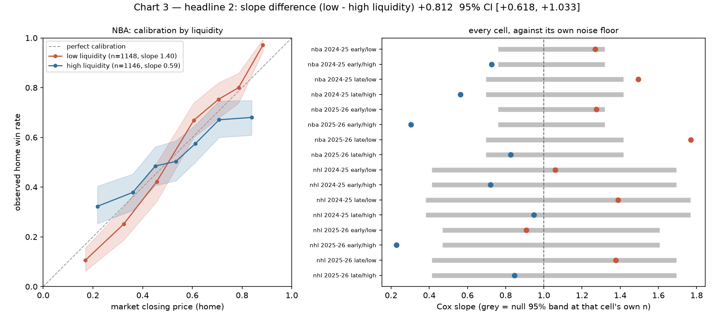
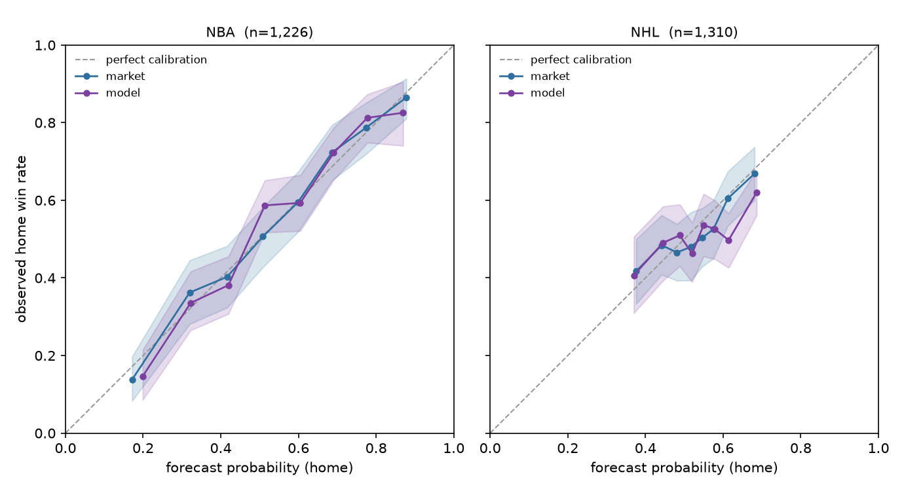

# Where a real-money market is miscalibrated

**Thin Polymarket sports markets are underconfident. Liquid ones are overconfident. The gap
is large, and it survives every check we could throw at it.**

Artifact v2, 23 October 2026. Both headlines are now here. **Headline 2**, below, is
unchanged from artifact v1 of 25 September 2026. **[Headline 1](#headline-1-a-transparent-model-against-the-markets-close)**,
a transparent model against the market's close on the sealed 2025-26 season, follows it:
parity in both sports (NBA +0.01152, NHL +0.00499 Brier, both under the pre-registered
0.02–0.03 band). In the NHL that parity is close to empty: the model beats a constant set at
the previous season's home-win rate, but not one set at the season's own. Pre-registered in
[PREREGISTRATION.md](https://github.com/arjasa1103/Chira/blob/main/PREREGISTRATION.md)
before any statistic was computed, with every amendment and deviation dated and its reason
recorded.

---

## The result

In NBA moneyline markets, the logistic (Cox) calibration slope is:

| Liquidity stratum | Cox slope | n |
|---|---|---|
| **low** | **+1.398** | 1,148 |
| **high** | **+0.586** | 1,146 |
| **difference (low − high)** | **+0.812** | 95% CI **[+0.602, +1.037]** |

A slope above 1 means the market is **underconfident**: prices sit closer to 0.50 than the
outcomes justify, so a 0.70 favourite wins more often than 70% of the time. Below 1 means
**overconfident**: prices are too extreme. Thin markets do the first, liquid markets do the
second, and the difference is about 0.8 in slope units.

The interval quoted is the **date-clustered** one, which is the wider of the two we computed.
The pre-registered game-level bootstrap gives [+0.618, +1.033]. No bootstrap replicate of
2,000 reproduced the opposite sign under either scheme, so the achieved significance level is
**< 0.0005** — a floor set by the replicate count, not a measured zero, and a bootstrap ASL
rather than a null-hypothesis p-value.



Left: the two calibration curves, with 95% bootstrap bands. Right: every stratum cell's
slope against the grey band a **perfectly calibrated** market could produce at that cell's
own sample size. That grey band is the reason this page makes a pooled claim and not sixteen
per-cell ones.

---

## What was measured

Every NBA and NHL regular-season game in 2024-25 and 2025-26, matched to its Polymarket
moneyline market:

| | Games |
|---|---|
| Scheduled | 5,084 |
| Priced (market found, closing price extracted) | 4,661 |
| Classified misses (421 no market, 2 no pre-tipoff price) | 423 |
| Raw minute-level price observations stored | 145,626,599 |

Coverage is 99.9% and 99.7% for NBA, 99.8% for NHL 2025-26, and 68.3% for NHL 2024-25 —
that last one because Polymarket listed no NHL markets before December 2024, which is a
launch date, not a collection failure.

The closing price is the home-side token's last quote at or before the **league's own**
tipoff time. It is not Polymarket's `gameStartTime`: that field disagreed with the league by
more than 15 minutes on 69 priced games, by up to 360 minutes, which admits in-game prices
into a "closing" price. One market stored 0.9995 on a game that finished 115-113. That
correction is [Amendment 1](https://github.com/arjasa1103/Chira/blob/main/PREREGISTRATION.md)
and the original-definition value is kept for every game so any result can be re-run both
ways.

All analysis runs against an immutable Parquet snapshot, `census-20260913-224d6ad985e0`,
content-hashed per file, never against the live API.

### The market overall, before stratifying

| Sport | Season | n | Brier | ECE | Cox slope | Resolution |
|---|---|---|---|---|---|---|
| NBA | 2024-25 | 1,229 | 0.1992 | 0.0271 | 0.990 | 0.048 |
| NBA | 2025-26 | 1,226 | 0.1941 | 0.0241 | 1.045 | 0.052 |
| NHL | 2024-25 | 896 | 0.2304 | 0.0349 | 1.024 | 0.015 |
| NHL | 2025-26 | 1,310 | 0.2446 | 0.0321 | 0.790 | 0.005 |

Unstratified, **the market looks well calibrated** — every ECE sits inside its own simulated
noise floor, and reliability is 0.0006 to 0.0015 against an uncertainty of about 0.247. The
liquidity result is invisible at this level because the two strata pull in opposite
directions and cancel. That is the point of stratifying.

The resolution column is the other headline: it measures how far prices move away from the
base rate. NBA closing prices beat "always pick the home team" by 0.048-0.052 Brier. **NHL
2025-26 beats it by 0.005.** A market that quotes near the base rate is perfectly calibrated
and nearly uninformative, which is why NHL is reported here as a contrast case and the
primary test runs on NBA
([Amendment 3b](https://github.com/arjasa1103/Chira/blob/main/PREREGISTRATION.md)).

---

## How the strata are defined

A 2×2: liquidity × season phase, both as equal-count median splits **inside each
sport-season**, ties to the early and low side.

| Sport-season | week median | volume median, early | volume median, late | no volume |
|---|---|---|---|---|
| NBA 2024-25 | 13 | $216,662 | $383,193 | 0 |
| NBA 2025-26 | 13 | $1,765,497 | $2,478,575 | 161 |
| NHL 2024-25 | 18 | $38,376 | $80,082 | 0 |
| NHL 2025-26 | 13 | $469,215 | $791,663 | 157 |

**Liquidity is cut inside each phase, not inside the season, and that detail decides the
result.** Volume climbs steeply through a season (Spearman +0.36 to +0.53 against week of
season), so the pre-registered within-season cut put 66-72% of low-liquidity games in the
early phase. The two axes of the 2×2 were nearly the same cut, and the primary test is a
difference *between* strata, so the confound would have landed directly on the headline.
Cutting within phase restores balance to 0.503-0.534 and evens the cells to 221-312 games.
This was measured and fixed before the test ran
([Amendment 3a](https://github.com/arjasa1103/Chira/blob/main/PREREGISTRATION.md)).

---

## Robustness

Every split points the same way. All exploratory under the pre-registered family-wise policy,
which reserves confirmatory status for the single primary test above.

| Check | difference | 95% CI | excludes zero |
|---|---|---|---|
| At the close (primary) | +0.812 | [+0.618, +1.033] | yes |
| T−1h | +0.826 | [+0.620, +1.014] | yes |
| T−6h | +0.834 | [+0.633, +1.043] | yes |
| T−24h | +0.853 | [+0.638, +1.083] | yes |
| 2024-25 only | +0.741 | [+0.464, +1.036] | yes |
| 2025-26 only | +0.911 | [+0.617, +1.241] | yes |
| stale closes only (n=485/435) | +0.866 | [+0.582, +1.195] | yes |
| fresh closes only (n=663/711) | +0.770 | [+0.511, +1.055] | yes |
| date-clustered bootstrap (311 dates) | +0.812 | [+0.602, +1.037] | yes |

The four time-to-close looks are four looks at **one** sample, so they are four intervals and
never one combined interval, which would be too narrow by construction.

### The artifact that could have explained it away

Volume is outcome-correlated: close games attract volume. That predicts high-liquidity games
cluster near 0.50, and they do — sd of logit price 0.949 against 1.207, with 50.7% inside
[0.35, 0.65] against 31.5%. A slope fitted over a narrower price range **attenuates toward
zero**, so the entire contrast might have been a range effect rather than a calibration
difference.

| Check | difference | 95% CI | excludes zero |
|---|---|---|---|
| restricted to p ∈ [0.20, 0.80] | +0.659 | [+0.358, +0.953] | yes |
| restricted to p ∈ [0.35, 0.65] | +0.512 | [−0.190, +1.329] | **no** |
| caliper-matched on \|logit p\|, 917 pairs | +0.804 | [+0.559, +1.057] | yes |

Matching equalises the price spread almost exactly (sd 0.595 against 0.593) and returns
+0.804, indistinguishable from the unmatched +0.812. **The contrast is not a price-range
artifact.** In the narrowest band the sign holds but the interval opens up: n falls to
362/581 and the price range is nearly flat, which is what an underpowered test looks like.

### Why clustering barely changed anything

Le (2026) reports that under event-clustered standard errors roughly half of raw
calibration-slope variation is estimation noise, so we computed a date-clustered bootstrap
as well. It widened the interval by 5% (width 0.435 against 0.415) and left the conclusion
intact. The reason is structural rather than lucky: the estimand is a **within-date
difference** between two strata that appear on the same nights, so a shock shared by a whole
slate largely cancels. Clustering would matter if the *gap itself* varied by date, and our
test suite checks exactly that case.

---

## Read the per-cell numbers with their noise floor

<details>
<summary>All 16 cells (click to expand)</summary>

| Cell | n | slope | null slope 95% band | ECE | null ECE p99 |
|---|---|---|---|---|---|
| NBA 2024-25 early/low | 316 | +1.269 | [0.760, 1.319] | 0.0510 | 0.0991 |
| NBA 2024-25 early/high | 315 | +0.726 | [0.760, 1.319] | 0.0666 | 0.0991 |
| NBA 2024-25 late/low | 299 | **+1.494** | [0.696, 1.417] | 0.0829 | 0.1299 |
| NBA 2024-25 late/high | 299 | **+0.563** | [0.696, 1.417] | 0.0817 | 0.1299 |
| NBA 2025-26 early/low | 321 | +1.276 | [0.760, 1.319] | 0.0503 | 0.0991 |
| NBA 2025-26 early/high | 320 | **+0.303** | [0.760, 1.319] | 0.1071 | 0.0991 |
| NBA 2025-26 late/low | 212 | **+1.769** | [0.696, 1.417] | 0.0962 | 0.1299 |
| NBA 2025-26 late/high | 212 | +0.826 | [0.696, 1.417] | 0.0673 | 0.1299 |
| NHL 2024-25 early/low | 227 | +1.059 | [0.414, 1.694] | 0.0639 | 0.1288 |
| NHL 2024-25 early/high | 226 | +0.721 | [0.414, 1.694] | 0.0762 | 0.1288 |
| NHL 2024-25 late/low | 222 | +1.389 | [0.382, 1.767] | 0.0811 | 0.1414 |
| NHL 2024-25 late/high | 221 | +0.947 | [0.382, 1.767] | 0.0594 | 0.1414 |
| NHL 2025-26 early/low | 333 | +0.907 | [0.470, 1.605] | 0.0790 | 0.1118 |
| NHL 2025-26 early/high | 332 | +0.229 | [0.470, 1.605] | 0.0881 | 0.1118 |
| NHL 2025-26 late/low | 244 | +1.377 | [0.414, 1.694] | 0.0665 | 0.1288 |
| NHL 2025-26 late/high | 244 | +0.846 | [0.414, 1.694] | 0.0873 | 0.1288 |

Bold slopes fall outside their own null band. Every number here is in
[charts/headline2.json](charts/headline2.json).

</details>

**Low exceeds high in all 8 sport-season × phase pairs, NHL included.** Eight subsamples, one
direction, is the strongest thing in the table.

**And yet no single cell should be read as a finding.** At NHL n=225, a market that is
*perfectly calibrated by construction* produces an ECE up to 0.1288 at the 99th percentile
and a slope anywhere in [0.414, 1.694]. Those bands come from simulating the null on the
census's own price distribution, 1,500 replicates per sample size. Per-cell calibration at
this n is close to unfalsifiable, so the claim lives in the pooled contrast and its interval.
Reporting the bands is not modesty; it is what makes the pooled claim legible.

---

## What this is not

- **Not blind.** Candidate strata designs were evaluated in week 5 with Cox slope point
  estimates visible on real outcomes, so the direction of this result was known to the author
  before the pre-registered analysis ran. The design was chosen on orthogonality and cell
  balance — both computable without outcomes — and the contrast was near-identical under all
  three candidates, so the choice cannot have been selecting the largest difference. That is
  still a permanent loss of blindness, recorded in
  [Amendment 3c](https://github.com/arjasa1103/Chira/blob/main/PREREGISTRATION.md) with the
  point estimates that were visible. What was genuinely untested until the run: every
  interval, the phase axis, the per-cell structure, the robustness splits, and the
  range-artifact checks.
- **Not a betting edge, and not advice.** This measures calibration. There is no staking
  model, no transaction costs, no bid-ask spread, and no liquidity model for getting size
  down in exactly the thin markets where the effect is largest. A calibration gap is not a
  return.
- **Not causal.** Volume is terminal cumulative volume: it is measured after the fact, it is
  mutable upstream, and it correlates with how close a game turned out. Caliper matching
  removes the price-range channel, not every path from outcome to volume.
- **Not complete in coverage.** 318 games have no per-market volume in Polymarket's API at
  all — a contiguous March 2026 block, confirmed against three endpoints — so they are
  excluded from the liquidity axis and never proxied. They are late-season, so NBA 2025-26's
  late cells hold 212 games against 321 early. An event-level proxy was adopted and then
  **withdrawn on measurement**: it exists for only ~36% of them and reads $350-$11,169
  against season medians of $604k and $2.03M
  ([Amendment 4](https://github.com/arjasa1103/Chira/blob/main/PREREGISTRATION.md)).
- **Not a finished test plan.** Six of the seven designated P1 tests are in place. The
  seventh, a leakage canary, guards point-in-time feature machinery that does not exist yet;
  it is scheduled with that code rather than counted here.
- **Not a dataset release.** Polymarket's terms define "Data" to include derived and
  aggregated forms and restrict redistribution, so this project publishes code and results,
  not data. Regenerate the census yourself with the commands below.
- **One platform, two sports, two seasons.** Nothing here says anything about other venues,
  other sports, or other years.
- **Brier is primary here; one cited paper would rank differently.** Wheatcroft (2019) finds
  the log score outperforms both the RPS and Brier. Our pre-registration chose Brier as
  primary for boundedness, and reports clipped log loss alongside. See
  [prior art](prior-art.md).

---

## Headline 1: a transparent model against the market's close

**A simple, transparent model reaches parity with Polymarket's closing price in both sports,
by the measure fixed before it was fitted. In the NHL that parity is close to empty: neither
forecaster says much, and the model beats a constant set at the previous season's home-win
rate but not one set at the season's own.**

| Sport | Priced games | Brier deficit, model − market (same games) | Pre-registered band |
|---|---|---|---|
| NBA | 1,226 | **+0.01152** | 0.02–0.03 |
| NHL | 1,310 | **+0.00499** | 0.02–0.03 |

**Read the NHL row with this beside it.** The NHL model, at **0.24971**, sits between two
constant forecasters:

| NHL constant, every 2025-26 game | Home rate used | Brier | Against the model |
|---|---|---|---|
| **hindsight**: 2025-26's own home-win rate | 0.5221 | **0.24951** | beats it |
| **ex-ante**: 2024-25's home-win rate, as of 2026-10-23 | 0.5625 | **0.25114** | loses to it |

The hindsight constant bounds what any constant could have done, because nobody knew the
season's home rate before the season. The ex-ante one is a forecast someone could actually
have committed to. All of the gap between them comes from the NHL's home-win rate falling
between seasons. The ex-ante baseline is **as of 2026-10-23, to be re-run at the end of the
2026-27 season**.

The NHL market resolves outcome variance **0.00571**, about **a ninth** of the NBA market's
0.05201. The NHL deficit is small because there is almost nothing to be better at, not
because the model got close to a good forecaster.

The pre-registration
([section 11](https://github.com/arjasa1103/Chira/blob/main/PREREGISTRATION.md)) fixed the
test before any model was fitted: headline 1 is **falsified as parity** if the model's holdout
Brier deficit against the market exceeds 0.02–0.03. Both deficits are below the band's lower
edge, so it passes in both sports. In the NBA the pass means something: the model resolves
79% of what the market resolves. In the NHL it does not, for the reason above.

The deficit compares the two forecasters on **exactly the games that have a closing price**.
Do not re-derive it from the score tables below, where the model is scored on every game
and the market only on priced ones; subtracting across them gives +0.01179 and +0.00512,
which this project's own first note did before review caught it.

### What was scored

- **The model.** A hierarchical logistic regression. Its inputs are a pre-game Elo rating,
  with constants tuned on 2024-25 and frozen on 2026-10-01; rest days, back-to-backs, travel
  distance and time-zone shift; and pooled team-season strength and home advantage. Fitted on
  **2024-25 only**, and frozen by commit `dc384cc5f4f6` before the holdout was opened.
- **The holdout.** The whole **2025-26** season: 1,230 NBA games (1,226 with a closing price)
  and 1,312 NHL games (1,310 priced). It was sealed from the start of the project. It was
  opened **once**, by code, on 2026-10-06, and that function refuses a second call.
- **The market.** Polymarket's closing midpoint for the home side. The market price never
  enters the model.
- **One thing the holdout changes about the model.** Every 2025-26 team-season is unseen by a
  2024-25 fit (30 of 30 NBA, 32 of 32 NHL), so the team-season effects are integrated out
  rather than estimated. On the holdout, the model is in effect the Elo plus schedule terms.

Both fits converged cleanly: 0 divergences, max R-hat 1.0013 (NBA) and 1.0006 (NHL), against
the pre-registered ceiling of 1.01.

### The scores

**NBA**

| Forecaster | n | Brier | Log loss | ECE |
|---|---|---|---|---|
| market (close) | 1,226 | **0.19413** | 0.56879 | 0.02407 |
| frozen Elo | 1,230 | 0.20421 | 0.59517 | 0.02843 |
| model | 1,230 | 0.20592 | 0.59827 | 0.03001 |
| model, priced games only | 1,226 | 0.20566 | 0.59770 | 0.03302 |
| base rate, hindsight (2025-26's rate) | 1,230 | 0.24703 | 0.68720 | 0.04228 |
| base rate, ex-ante (2024-25's rate) | 1,230 | 0.24714 | 0.68743 | 0.04407 |

**NHL**

| Forecaster | n | Brier | Log loss | ECE |
|---|---|---|---|---|
| market (close) | 1,310 | **0.24459** | 0.68207 | 0.03209 |
| **base rate, hindsight (2025-26's rate)** | 1,312 | **0.24951** | 0.69217 | 0.01826 |
| model | 1,312 | 0.24971 | 0.69302 | 0.05641 |
| model, priced games only | 1,310 | 0.24958 | 0.69274 | 0.05561 |
| frozen Elo | 1,312 | 0.25065 | 0.69488 | 0.06264 |
| base rate, ex-ante (2024-25's rate) | 1,312 | 0.25114 | 0.69547 | 0.04040 |

Log loss is clipped to [0.01, 0.99]; Brier is primary, for the reason in
[PLAN.md](https://github.com/arjasa1103/Chira/blob/main/PLAN.md) Phase 5. In the NHL, only
the hindsight base rate outscores the model and the rating; the ex-ante one, as of
2026-10-23, is beaten by both. The two base rates are constants scored on every game.

### Where the gap comes from

Brier decomposes into reliability (how far the forecasts are off; lower is better) minus
resolution (how much they separate wins from losses; higher is better) plus the outcome's
own uncertainty.

| | Reliability | Resolution | Uncertainty |
|---|---|---|---|
| NBA market | 0.00095 | **0.05201** | 0.24710 |
| NBA model | 0.00135 | **0.04118** | 0.24703 |
| NHL market | 0.00136 | **0.00571** | 0.24948 |
| NHL model | 0.00406 | **0.00362** | 0.24951 |

**The NBA gap is mostly resolution.** The model is nearly as well calibrated as the market,
but it separates games less sharply: 0.04118 against 0.05201, or **79%**. That is the
information a schedule-and-rating model does not have, such as injuries, rest decisions and
lineup news. **In the NHL both resolutions are tiny**, and the model's reliability term is
the larger of its two.

The decomposition is binned, so its three terms add up to a Brier within 0.002 of the exact
one.



Model and market reliability curves, priced games only. Both curves use the same six bins,
cut on the market price's quantiles so the x-axis is shared. Bands are 95% game bootstraps.
Cox calibration slopes:

| | Cox slope | 95% null band at this n | |
|---|---|---|---|
| NBA market | 1.045 | [0.868, 1.154] | inside |
| NBA model | 1.081 | [0.868, 1.154] | inside |
| NHL market | 0.790 | [0.740, 1.267] | inside |
| NHL model | **0.557** | [0.740, 1.267] | **below** |

The null band is the range a **perfectly calibrated** forecaster's slope covers at that
sample size, simulated on the census's own prices. The NBA model cannot be told apart from
calibrated. The NHL model is the one outside its band, and below it: its forecasts are too
extreme. Bucketed by the model's own probability, the NHL games it put at 0.60 and 0.70
were won at 0.53 and 0.62.

### Does the model add anything to the market?

**No, in the NBA, under every construction tested.** This is the nested test: a model "B"
that contains the market's price plus the model's covariates, scored against the market
alone by a Clark-West statistic, with a bootstrap over calendar dates. B is tested against
two versions of the market: the raw price ("identity"), and the price recalibrated through a
logistic fitted on 2024-25.

| | Null | CW | Bootstrap p | n (dates) |
|---|---|---|---|---|
| **NBA (primary)** | **identity** | **−1.061** | **0.870** | 1,226 (164) |
| NBA | recalibrated | −0.967 | 0.839 | 1,226 (164) |
| NHL | identity | +0.671 | 0.218 | 1,310 (167) |
| NHL | recalibrated | +2.355 | 0.003 | 1,310 (167) |

The NBA is the pre-registered primary sample, and its test is null in the strongest sense
available. The CW statistic is negative even after the adjustment that credits B for its
extra parameters. The one-hour-before-close prices give the same pattern (NBA CW −1.002 and
−0.928).

**The NHL row that looks significant is a recalibration effect, not new information.**
Against the market's actual price, B adds nothing (p 0.218). Against the recalibrated price,
it appears to (p 0.003). But it is the same B, on the same games, with the same covariates.
Its mean adjusted advantage is 0.00080 over the raw price and 0.00182 over the recalibrated
one. What moved is the baseline: B contains that recalibration, so part of what it is
credited for is undoing it. The result is also an inversion from the 2024-25 rehearsal,
where every NHL statistic sat near zero on 717 games. With the season sealed again by use,
it stays an open question.

### Risk tiers

These are pre-registered as exploratory, never headline. Games are grouped by how far the
model's price is from the market's, `|p_model − p_market|`. "Model-side hit" is how often the
outcome went the way the model leaned *relative to the market*.

**NBA: 1,226 priced games, 203 under the 0.02 floor and not tiered**

| Tier | Edge | n | Model-side hit | 95% CI |
|---|---|---|---|---|
| T1 | 0.02–0.05 | 311 | 0.402 | [0.347, 0.460] |
| T2 | 0.05–0.10 | 360 | 0.314 | [0.269, 0.361] |
| T3 | ≥ 0.10 | 352 | 0.324 | [0.276, 0.378] |

**Every NBA tier's interval lies entirely below 0.5.** Where the model disagreed with the
NBA close, the market was right 60–69% of the time, and most often where the model
disagreed most. The pre-registration expected the top tier's apparent edge to *shrink* out
of sample. Instead, every tier's edge reversed.

**NHL: 1,310 priced games, 333 under the floor**

| Tier | Edge | n | Model-side hit | 95% CI |
|---|---|---|---|---|
| T1 | 0.02–0.05 | 404 | 0.446 | [0.396, 0.495] |
| T2 | 0.05–0.10 | 427 | 0.522 | [0.471, 0.569] |
| T3 | ≥ 0.10 | 146 | 0.425 | [0.349, 0.507] |

In the NHL, nothing here is a disagreement worth acting on in either direction.

### Against its own rating

The model was built on the frozen Elo, so the obvious secondary question is whether it beats
that rating. On the holdout it does not, and it does not lose either. The model minus the
Elo is **+0.00171** Brier in the NBA and **−0.00094** in the NHL, both far inside anything
this sample can separate. The framing was written down on 2026-10-04, before the holdout
opened: *out of sample the model does not beat the Elo it is built on*. It holds in the NBA,
is weakened in the NHL, and is not amended.

### Deviations, stated plainly

- **Deviation 1 (2026-10-01): holdout scores were seen before the seal.** A summary table
  scored the frozen Elo against 2025-26 outcomes, for both sports, before the holdout was
  opened. The NHL values were quoted at the time (log loss 0.69488, Brier 0.25065). The
  Elo's constants had already been frozen and pushed, so that choice could not have been
  affected. The rule adopted that day held for everything after: **no model change may be
  justified by holdout behaviour, and none was made.** It is now enforced in code: a sealed
  row cannot be scored until the marker exists.
- **Deviation 2 (2026-10-06): the runner crashed after the seal opened, and was fixed
  after.** It had never been executed or reviewed before the opening. It died on a function
  signature changed in a review two days earlier, after printing the NBA score table and the
  NBA deficit. The fix added a recomputation path that requires the seal's marker and
  refuses unless the labels hash to what the marker recorded. It touched no model, fit,
  prediction, scoring function or seed. That recomputation reproduced the NBA numbers the
  crashed run had printed. A second recomputation, on 2026-10-23, reproduced every value
  stored by the first and the figure above byte for byte.

Both are recorded in full in
[PREREGISTRATION.md](https://github.com/arjasa1103/Chira/blob/main/PREREGISTRATION.md).

### What headline 1 does not say

- **It does not say the model is good.** It says a transparent model made from a frozen
  rating and a schedule meets the pre-registered parity bar against a prediction market. In
  the NBA, where it disagrees with that market, it is **wrong more often than right, in every
  tier**.
- **It does not say the NHL is predictable.** Both forecasters sit within 0.005 Brier of a
  constant. The model is on the wrong side of the season's own home-win rate (0.24951) and on
  the right side of the previous season's (0.25114, as of 2026-10-23).
- **It is not a betting edge.** The risk tiers argue directly against one. There is no
  staking model, no fees and no fill model either.
- **The rating comparison on 2024-25 carries a bias that was disclosed and never measured.**
  The Elo's three constants were tuned on all of 2024-25, the same season the dev rehearsal
  scored, so on dev the rating was in-sample for three parameters while the model was not.
  The holdout is clean on this, because the constants never saw 2025-26. The size of the
  dev bias is unmeasured and listed as a limitation.
- **It cannot be repeated.** One season, opened once. The code refuses a second opening, and a
  recomputation refuses to write anything that does not reproduce the first look. Every
  number here is in
  [`docs/charts/holdout.json`](https://github.com/arjasa1103/Chira/blob/main/docs/charts/holdout.json),
  and the full account is the
  [week-9 note](https://github.com/arjasa1103/Chira/blob/main/notes/week9-holdout.md).
- **One platform, two sports, one season.**

---

## Prior art

Five sources. Two were read in full. Reichenbach and Walther (SSRN 5910522) refuses automated
access and was **read by hand on 2026-10-01**: it has no liquidity split and no NBA or NHL
markets, so the contribution stands. Wilkens (2026) was found on 2026-10-23 and is read at
the abstract only. One source **contradicts a claim our own plan made about it.** The closest work is Le (2026), which
decomposes the same estimand across 353M trades on Kalshi and Polymarket and finds
trade-size compression that is *not robust on Polymarket* — the platform where this result
sits. Full positioning: **[prior-art.md](prior-art.md)**.

---

## Reproduce it

No dataset to download. The census regenerates from public endpoints.

```bash
git clone https://github.com/arjasa1103/Chira && cd Chira
uv sync --extra store --group dev
uv run pytest -q                       # 711 tests, offline, Linux/macOS/Windows
uv run python scripts/reproduce.py      # prints the plan, runs nothing
uv run python scripts/reproduce.py --run
```

Full instructions, per-command costs and the resume path are in the
[README](https://github.com/arjasa1103/Chira/blob/main/README.md). The census is about
16,400 requests at 5 requests/second against a public API; it needs a residential IP because
`stats.nba.com` blocks most cloud ranges, and roughly 6 GB of disk.

Once the census and snapshot exist, headline 2's numbers come from one command:

```bash
uv run python scripts/run_headline2.py --reps 2000
```

The seed is fixed, so the point estimates and intervals reproduce exactly.

Headline 1's numbers are in
[`docs/charts/holdout.json`](https://github.com/arjasa1103/Chira/blob/main/docs/charts/holdout.json).
They come from a single pass over the sealed 2025-26 season, which cannot be repeated:

```bash
uv run python scripts/run_holdout.py     # readiness report; reads nothing from 2025-26
```

The two constant baselines are in
[`docs/charts/holdout-exante.json`](https://github.com/arjasa1103/Chira/blob/main/docs/charts/holdout-exante.json),
from `uv run python scripts/run_exante_baseline.py`, which reads the same released labels
and fits nothing.

With the seal's marker present, `--open-the-seal` **recomputes** from the labels already
released rather than opening anything. It refuses unless those labels hash to the value the
marker recorded, and it writes nothing unless the result reproduces what the first look
printed.

---

## Licence and citation

Code is MIT. This writeup, its figures and the statistics behind them are
[CC BY 4.0](https://creativecommons.org/licenses/by/4.0/). Neither grants rights over
Polymarket's market data or the leagues' data, which this project does not redistribute.

> Chira: where a real-money market is miscalibrated. Artifact v2, 23 October 2026 (v1,
> headline 2 only: 25 September 2026). Snapshot `census-20260913-224d6ad985e0`; model frozen
> at `dc384cc5f4f6`. https://github.com/arjasa1103/Chira
